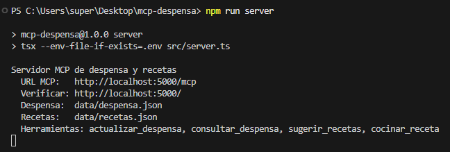
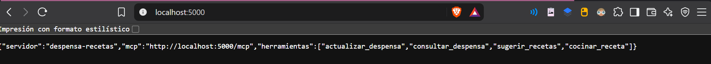
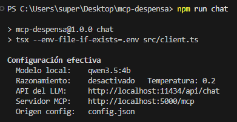
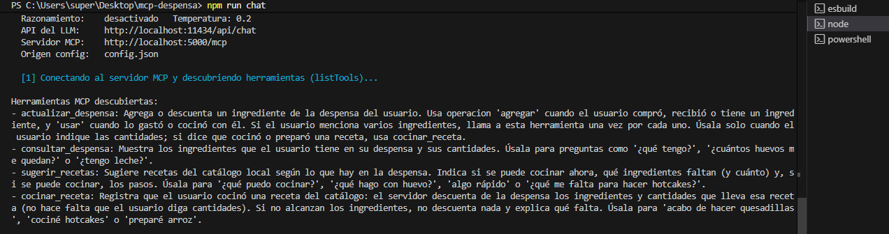
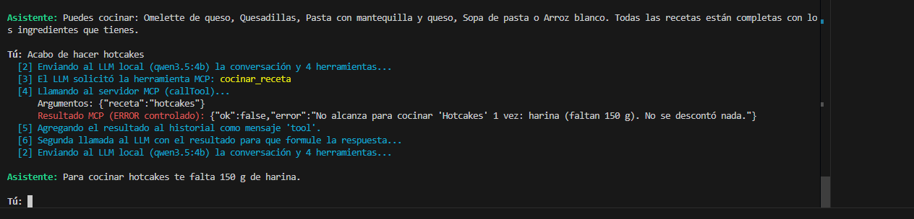
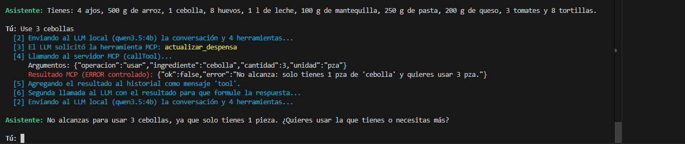
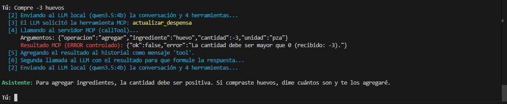

# Despensa y Recetas — Asistente con MCP y LLM local

Asistente de consola que administra la **despensa de una cocina** y sugiere recetas según lo que hay disponible. Un modelo de lenguaje local (Ollama) decide cuándo y con qué parámetros invocar las herramientas que expone un servidor **MCP** propio, escrito en TypeScript.

```
                                                   Usuario
                                                      |
                                                      V
                                                Cliente/chat
                                                      |
                                                      V
                                              LLM local (Ollama)
                                                      |
                                                      V
                                                  Llamada MCP
                                                      |
                                                      V
                                              Herramienta (JSON)
                                                      |
                                                      V
                                              LLM local (Ollama)
                                                      |
                                                      V
                                            Respuesta al usuario
```

## Configuración

Ninguna dirección ni nombre de modelo está fija en el código. Todos se pueden cambiar con el archivo de configuración, con variables de entorno o con argumentos de línea de comandos. Si se usan varias a la vez, el orden de prioridad es: **argumentos > variables de entorno > `config.json`**

### Servidor — variables de entorno (`.env.example`)

```bash
HOST=localhost                    # host donde escucha el servidor
PORT=5000                         # puerto
DESPENSA_FILE=data/despensa.json  # archivo con la despensa
RECETAS_FILE=data/recetas.json    # catálogo de recetas
```

El endpoint MCP es `http://<HOST>:<PORT>/mcp`.

### Cliente — `config.json`

Si faltan `config.json` o `.env`, créalos a partir de los archivos de ejemplo:

```bash
cp config.example.json config.json
cp .env.example .env
```

```json
{
  "mcp": {
    "url": "http://localhost:5000/mcp"
  },
  "llm": {
    "provider": "ollama",
    "baseUrl": "http://localhost:11434",
    "chatPath": "/api/chat",
    "model": "qwen3.5:4b",
    "think": false,
    "temperature": 0.2
  }
}
```

`think: false` desactiva el razonamiento de Qwen3.5 (respuestas mucho más rápidas con un modelo de 4B).

### Cambiar la configuración sin editar archivos

| Valor | Argumento | Variable de entorno | `config.json` |
|---|---|---|---|
| URL del servidor MCP | `--mcp-url` | `MCP_URL` | `mcp.url` |
| URL base del LLM | `--llm-url` | `LLM_BASE_URL` | `llm.baseUrl` |
| Ruta de chat del LLM | `--chat-path` | `LLM_CHAT_PATH` | `llm.chatPath` |
| Modelo | `--model` | `LLM_MODEL` | `llm.model` |
| Razonamiento (`true`, `false`, `auto`) | `--think` | `LLM_THINK` | `llm.think` |
| Temperatura | `--temperature` | `LLM_TEMPERATURE` | `llm.temperature` |
| Archivo de configuración | `--config` | `CONFIG_FILE` | — |
| Mostrar peticiones al LLM | `--debug` | `DEBUG=1` | — |


## Instalación y ejecución

### Requisitos

- [Node.js 20 o superior](https://nodejs.org)
- [Ollama](https://ollama.com/download), actualizado a una versión reciente
- Un modelo con soporte de herramientas (*tool calling*). El proyecto se probó con `qwen3.5:4b`.

### Paso 1. Obtener el proyecto

```bash
git clone https://github.com/Shyneoblaster/MCP_Despensa_y_Cocina
cd mcp-despensa
```

O descomprime el `.zip` y entra a la carpeta.

### Paso 2. Instalar las dependencias

```bash
npm install
```

Paquetes que se instalan:

| Uso | Paquetes |
|---|---|
| Servidor | `@modelcontextprotocol/sdk`, `express`, `zod` |
| Cliente | `@modelcontextprotocol/sdk` (cliente MCP) y `fetch` nativo de Node para hablar con Ollama |
| Desarrollo | `typescript`, `tsx`, `@types/node`, `@types/express` |

### Paso 3. Iniciar Ollama

Si Ollama ya está corriendo como servicio (lo habitual en Windows y Mac), omite este paso. Si no, ejecútalo en una terminal y déjala abierta:

```bash
ollama serve
```

### Paso 4. Descargar el modelo local

En otra terminal (la descarga pesa unos 3.3 GB):

```bash
ollama pull qwen3.5:4b
ollama list          # debe aparecer qwen3.5:4b
```

### Paso 5. Ejecutar el servidor MCP

Desde la raíz del proyecto, en una terminal que debe quedar abierta:

```bash
npm run server
```

Para comprobar que está activo, abre `http://localhost:5000/` en el navegador (devuelve un JSON con las herramientas). El endpoint `/mcp` solo acepta POST, así que abrirlo con el navegador muestra "Método no permitido"; es el comportamiento esperado.

### Paso 6. Ejecutar el cliente de chat

En otra terminal, desde la raíz del proyecto y con el servidor ya iniciado:

```bash
npm run chat
```

La primera respuesta puede tardar mientras Ollama carga el modelo en memoria.

### Uso del chat

Comandos disponibles:

| Comando | Acción |
|---|---|
| *(cualquier texto)* | Envía una pregunta al asistente. Se pueden hacer varias en la misma sesión. |
| `/nuevo` | Borra el historial e inicia una conversación nueva. |
| `salir` (o `/salir`) | Termina el programa. |

Ejemplos de preguntas:

- `¿Qué tengo en la despensa?`
- `Compré 6 huevos y 1 kilo de arroz.`
- `¿Qué puedo cocinar en menos de 15 minutos?`
- `¿Qué me falta para hacer hotcakes?`
- `Acabo de hacer quesadillas.`

Por cada consulta, el cliente muestra el flujo completo: envío al LLM, herramienta solicitada, argumentos, resultado MCP, segunda llamada al LLM y respuesta final. Si el modelo pide varias herramientas, el ciclo se repite (máximo 6 vueltas por pregunta).

## Herramientas MCP

Todas las herramientas devuelven un objeto JSON con la misma forma: `{ "ok": true, ... }` si funcionan, o `{ "ok": false, "error": "mensaje comprensible" }` (con `isError: true` en MCP) si algo falla.

| Herramienta | Parámetros | Qué hace | Validaciones |
|---|---|---|---|
| `actualizar_despensa` | `operacion` (`agregar` / `usar`), `ingrediente` (string), `cantidad` (número), `unidad` (string) | Suma o descuenta un ingrediente de la despensa. | Operación solo `agregar` o `usar`; ingrediente solo con letras y espacios (máx. 40); cantidad > 0, máx. 3 decimales y máx. 100,000; unidades `g`, `kg`, `ml`, `l`, `pza` (y alias como gramos, kilos, litros, piezas); no se mezclan unidades de distinta clase; al usar, el ingrediente debe existir y alcanzar la cantidad. |
| `consultar_despensa` | `ingrediente` (opcional), `limite` (opcional) | Muestra los ingredientes y cantidades; con `ingrediente` filtra uno. | Ingrediente válido; límite entero entre 1 y 100 (20 por defecto); avisa si no hay coincidencias. |
| `sugerir_recetas` | `solo_completas` (opcional), `max_minutos` (opcional), `ingrediente` (opcional), `limite` (opcional) | Sugiere recetas del catálogo según la despensa: indica si se pueden cocinar, qué falta y los pasos. | `max_minutos` entero entre 5 y 600; ingrediente válido; límite entero entre 1 y 20 (5 por defecto). |
| `cocinar_receta` | `receta` (string), `veces` (opcional) | Descuenta de la despensa los ingredientes que lleva una receta. Las cantidades las pone el servidor, no el modelo. | Receta con al menos 3 letras; acepta nombres parciales (`omelette`); rechaza nombres ambiguos o inexistentes; `veces` entero entre 1 y 10; **atómica**: si falta cualquier ingrediente no descuenta nada y explica qué falta. |

Detalles de la lógica:

- `kg` y `l` se convierten a `g` y `ml`; "huevos", "Huevo" y "huevos" son el mismo ingrediente (plurales y acentos normalizados).
- Se asume que siempre hay sal, agua y aceite, por eso no aparecen como ingredientes de las recetas.
- `sugerir_recetas` ordena primero las recetas que ya se pueden cocinar y luego las que tienen mayor porcentaje de ingredientes disponibles.

Los datos se guardan en archivos JSON (`data/despensa.json` y `data/recetas.json`).

## Estructura del proyecto

```
mcp-despensa/
├── package.json                  Scripts: server, chat, test:store, typecheck
├── tsconfig.json
├── config.json                   Configuración del cliente (copiada de config.example.json)
├── config.example.json           Configuración del cliente de ejemplo (sin secretos)
├── .env                          Variables de entorno del servidor (copiada de .env.example)
├── .env.example                  Variables de entorno de ejemplo
├── data/
│   ├── despensa.json             Despensa (se modifica al usar el asistente)
│   ├── despensa.seed.json        Copia de la despensa inicial, para restaurarla
│   └── recetas.json              Catálogo de 14 recetas
├── evidencias/                   Capturas de la ejecución
└── src/
    ├── server.ts                 Servidor MCP por HTTP: host/puerto desde variables de entorno
    ├── store.ts                  Validaciones y reglas de negocio (sin MCP)
    ├── client.ts                 Chat de consola: conexión MCP, llamadas a Ollama y ciclo de herramientas
    ├── config.ts                 Carga de configuración (argumentos > entorno > archivo)
    └── test-store.ts             Pruebas de la lógica sin MCP ni LLM
```

Para ejecutar las pruebas de la lógica y la comprobación de tipos:

```bash
npm run test:store
npm run typecheck
```

## Datos de prueba

El proyecto incluye esta despensa inicial (`data/despensa.json`):

| Ingrediente | Cantidad |
|---|---|
| Huevo | 6 pza |
| Arroz | 500 g |
| Leche | 1000 ml |
| Tortilla | 8 pza |
| Queso | 200 g |
| Tomate | 3 pza |
| Cebolla | 2 pza |
| Pasta | 250 g |
| Mantequilla | 100 g |
| Ajo | 4 pza |

Con ella se pueden cocinar de inmediato: Omelette de queso, Quesadillas, Pasta con mantequilla y queso, Arroz blanco y Sopa de pasta.

El catálogo (`data/recetas.json`) tiene 14 recetas: Huevos revueltos con jamón, Omelette de queso, Quesadillas, Arroz blanco, Frijoles refritos, Pasta con mantequilla y queso, Sándwich de jamón y queso, Guacamole, Avena con plátano, Hotcakes, Ensalada de atún, Papas al ajo, Sopa de pasta y Pollo con arroz.

Casos de prueba sin ingredientes: **Hotcakes** (no hay harina) y **Pollo con arroz** (no hay pollo).

Para volver a los datos iniciales, copia `data/despensa.seed.json` encima de `data/despensa.json` y reinicia el servidor:

```bash
cp data/despensa.seed.json data/despensa.json
```

## Evidencias

Transcripciones o capturas de la ejecución del proyecto.

### 1. Servidor MCP iniciado y accesible en su URL

Salida del servidor (`npm run server`):



Respuesta en el navegador al abrir `http://localhost:5000/`:



### 2. Cliente mostrando el modelo, la URL del LLM y la URL del servidor MCP



### 3. Cliente descubriendo las herramientas MCP




### 4. Invocación de herramientas MCP y respuesta final

El modelo solicita la herramienta, el cliente hace la llamada real al servidor MCP y el modelo responde con base en el resultado.


### 5. Validación y error controlado

**Ingredientes insuficientes** (`cocinar_receta` es atómica y no descuenta nada):



**Cantidad mayor a la disponible** (`actualizar_despensa`):



**Dato inválido** (cantidad o unidad rechazada por el servidor):


